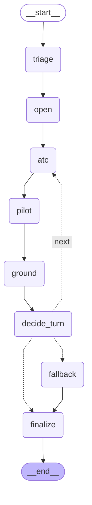

# Disruption Negotiator (Autonomous SG 2026, Airbus Challenge 2)

Design: `docs/superpowers/specs/2026-10-31-disruption-negotiator-design.md` · API contract: `docs/api-contract.md`

## 1. Pitch

When weather or a late inbound disrupts an arrival, the airline duty manager coordinates by phone between the tower, the crew and ground handling. This prototype replaces those calls with exactly three agents: ATC, PILOT (for the focus flight) and GROUND. The input is one real disrupted flight, a row of `data/challenge2/flights.csv` (DOT 2015, `WEATHER_DELAY > 15` or `LATE_AIRCRAFT_DELAY > 20`). The wave is built at its destination airport, with the other `flights.csv` arrivals in the same window as context and weather fetched on demand from IEM (cited). Each agent sees only its own domain and can only make moves inside its own authority. A deterministic rule engine decides whether any move or plan is legal; no model ever does. Decision models choose among the options the engine offers and vote. Claude only narrates the finished outcome for the duty manager and decides nothing. The default mode (formulas, chosen by the benchmark) makes no model calls at all; decision models and Claude narration run in `decision` and `decision+claude` modes. The output is a revised arrival (time, runway, gate, action, delay vs schedule) plus the full log, and the human approves or overrides. BTS Jun-Aug 2024 waves are still supported as a second source.

## 2. Live demo and local run

Live: https://disruption-negotiator.onrender.com

Render free tier: it sleeps when idle, so expect a cold start of about 1 minute.

Local:

```bash
pip install -r requirements.txt
uvicorn atm.server:app --port 8000        # API, MCP and (if built) the dashboard at http://localhost:8000
```

Frontend build (served at `/` from `frontend/dist` when present; without it the API still runs):

```bash
cd frontend && npm ci && npm run build
```

Docker (multi-stage: builds the frontend, then the Python API; listens on 7860):

```bash
docker build -t disruption-negotiator .
docker run -p 7860:7860 disruption-negotiator
```

Keys are optional and live in `.env` (gitignored): `OPENROUTER_API_KEY`, `TYPESAFE_API_KEY`, `ANTHROPIC_API_KEY`. With none set, negotiation runs on the local formulas and narration uses a deterministic template. The Docker image sets `ATM_REQUIRE_REAL=1`.

## 3. Architecture

Input: pick a flight with `GET /api/flights`, id `F2015-<row_id>` (BTS 2024 wave ids still work).



Protocol (`atm/wave/graph.py`, LangGraph). Per turn each agent (ATC, then PILOT, then GROUND) sends ONE `AGENT_TURN` message holding its moves, the moves the engine rejected with their violations, its proposal, its votes and a rationale. The engine runs a `CHECK` after every proposal. Consensus means all 3 agents `ACCEPT` the same plan that passed `CHECK`, within a turn. After at most 3 turns without consensus, a deterministic beam solver with a safety net produces the plan and the reason is logged.

Components (all under `atm/`):

- **Wave builder** (`wave/flights2015.py`, `wave/build.py`): builds the wave from a `flights.csv` row (or a BTS 2024 wave), real runways, METAR, FAA registry and OSM gates, plus seeded simulation of what no public source has. Deterministic per id.
- **Workbook limits** (`wave/constraints.py`): airport capacity, wake table, fuel and crew rules parsed from `data/challenge2/challenge2_operational_constraints.xlsx` (sheet `rules_of_play`), with hard-coded fallbacks equal to the workbook.
- **Rules engine** (`wave/rules.py`): every check is a formula, and every result cites rule, source and input values. Twelve rules:
  - `ATC-RWY-OPEN`: runway exists and is open.
  - `ATC-WAKE-SEP`: workbook wake distance (3-8 nm) between leader and follower on the same physical runway, converted to time at 140 kt (x1.25 when wet or low visibility).
  - `ATC-RWY-CAPACITY`: arrivals per runway per rolling 60 min within the workbook cap.
  - `ATC-TAXI-ROUTE`: taxi route to the gate is usable.
  - `ATC-WIND-LIMITS`: crosswind and tailwind from real METAR against FAA Order 8400.9 section 6d and demonstrated crosswind by type.
  - `PLT-EARLIEST-ETA`: no landing before the flight can physically arrive.
  - `PLT-FUEL-RESERVE`: hold fits within extra fuel above alternate plus 30 min final reserve.
  - `PLT-CREW-DUTY`: in-block (or alternate arrival) within 13 h of crew report time; report = scheduled departure - 60 min. A bust that even the earliest landing cannot avoid is reported, not vetoed.
  - `GND-GATE-SIZE`: gate fits the aircraft.
  - `GND-GATE-FREE`: gate not occupied, including by other wave flights, with the airport turnaround time.
  - `GND-GATE-NOTICE`: gate changes need at least 20 min notice.
  - `GND-CREW-DUTY`: reports ground overtime past the 8 h shift. It never vetoes; overtime is a cost.
- **Moves and authority** (`wave/moves.py`): ATC changes runway, slot and order. PILOT changes only its own flight (speed reduction, ground delay, divert, accept). GROUND changes gates only.
- **Utilities** (`wave/utility.py`): ATC scores the wave, PILOT its own flight, GROUND gates and crew (overtime at 1.5x). Voting uses a reservation schedule that drops each turn.
- **Safety**: every move and every proposal is engine-checked, votes are cast only on `CHECK`-passed plans, the final plan's feasibility is re-checked, and models only choose among offered options.
- **Decision layer** (`decide.py`): per call, a chain of OpenRouter models, then TypeSafe (Jev), then local formulas. Each call has a 2 s timeout and one retry on 429/5xx. A circuit breaker skips an entry for 60 s after 3 consecutive failures. Every fallback is logged and shown in the UI.
- **Fallback solver** (`wave/fallback.py`): beam search over legal moves maximising the worst agent's utility, with a remote-stand, ground-delay or divert safety net. Legality is still decided only by the rules engine. It never raises.
- **Narration** (`wave/narrate.py`): Claude writes the brief from the structured outcome; deterministic template on any failure.
- **API and SSE** (`server.py`): REST under `/api` (`/api/flights`, `/api/waves`, `/api/wave/{id}`, `/api/runs/{id}`, `/api/benchmark`, `/api/config`) and `POST /api/negotiate-wave`, which streams messages as server-sent events. Output is `result.revision` plus the full log. Contract v2.0 is `docs/api-contract.md`.
- **MCP server** (`mcp_server.py`): read-only, at `/mcp/sse`. Six tools: `list_waves`, `get_wave`, `fcfs_plan`, `legal_moves`, `check_plan`, `negotiate` (formulas only).

### Limits applied (`rules.LIMITS`, `rules.limits_for`)

Every change and assumption is returned in `result.limits`. Summary:

| Limit | What we do | Source |
|---|---|---|
| Wake separation | Workbook distances (`min_separation_nm`, 3-8 nm) converted to time at a 140 kt approach speed (3 nm = 77 s, 5 nm = 129 s, 8 nm = 206 s); same physical runway | workbook (nm column); 140 kt is an assumption |
| Wet or low-visibility factor | x1.25 on wake times | assumption |
| B757 | Treated as Heavy | assumption |
| Runways and wind | Real runways and METAR instead of the workbook runway count (used only as the capacity divisor) | real data |
| Runway capacity | `max_runway_ops_per_hour / active_runways` per runway; counts arrivals only | workbook, arrivals only |
| Turnaround, gates, spare gates | Per airport from workbook (turnaround 45/35 min, spare gates); wave models `min(gates, 12)` gates plus a remote stand with 2 positions | workbook; remote stand is an assumption |
| Fuel burn, reserve, spare | 2400 / 6500 kg/h, 30 min final reserve, 45 min spare fuel | workbook |
| Contingency fuel 5% | Not credited: it covers en-route deviations, and the workbook's 45 min spare-on-arrival is what is checked at the destination. Not crediting it is the conservative reading | assumption |
| Flight crew 13 h duty | Enforced by `PLT-CREW-DUTY`; report time = scheduled departure - 60 min | workbook; report offset is an assumption |
| Ground shift | 8 h, overtime at 1.5x is a cost, not illegal | workbook |
| Gate change notice | At least 20 min; remote stand exempt | workbook |
| Speed reduction | Capped at 8 min | assumption |

## 4. Data and provenance

| Layer | Source | Status |
|---|---|---|
| Focus flight, delays, context arrivals | DOT 2015 `flights.csv` (challenge file) | real |
| Second source: flights, delays, queue | BTS On-Time, Jun-Aug 2024, arrivals to 30 hubs | real |
| Runways (ends, headings, length) | OurAirports | real |
| Weather at arrival hour (wind, visibility, ceiling, wet/dry) | Iowa Environmental Mesonet METAR archive, fetched on demand and cited | real |
| Airport capacity, turnaround, wake table, fuel and crew rules | challenge workbook (synthetic planning numbers) | given by the challenge |
| Tail to aircraft type, wake category, gate size | FAA aircraft registry | real (US-registered tails) |
| Gates and wide-body gates | OpenStreetMap, 10 hubs | real |
| Gate occupancy | seeded simulation | simulated, badged |
| Fuel on board | seeded simulation | simulated, badged |
| Crew shifts | seeded simulation, anchored to the flight's actual delayed ETA | simulated, badged |
| Passenger connections | seeded simulation | simulated, badged |
| Two wide gates per hub where OSM has none | simulated | simulated, badged |

Layers missing for a flight fall back to a generic model and are badged in the UI.

## 5. Evaluation

**What the measured impact is:** every final plan obeys every rule (0 violations in every arm), while the uncoordinated status quo breaks at least one rule on 16 of 50 waves; with the rule engine switched off, 32% of the agents' plans are illegal; a decision takes about 1 s in formulas mode (`stats.elapsed_ms`). Delay is roughly neutral: on the 34 waves where the status quo is legal, the negotiated plans are about 2 min better in total. Negotiation buys legality and speed, not minutes.

Method (`python3 -m atm.wave.benchmark --n 50 --arms <models>,formula --concurrency 4 --seed 7`):

- 50 seeded `flights.csv` rows, stratified over the 30 busiest hubs (BTS 2024 waves remain available with `--source bts`).
- Selection rule: best outcome among arms with error < 2%, p95 < 1 s and consensus >= 90%; tie goes to lower Brier.
- Arms: each candidate decision model (full chain behavior, same waves), the formula arm (no model), and the status quo (FCFS slots, scheduled gates, no coordination).
- Metrics:
  - consensus %: waves that reached agreement within 3 turns; fallback % is the rest, ending in the deterministic solver.
  - error rate: % of decisions answered after the arm's model failed (non-empty `fallback_from`).
  - latency p50/p95: over model-answered decisions only.
  - Brier: mean `(p_accept - y)^2` over model-answered votes, where `y` is the formula verdict (utility at or above reservation). It measures agreement with the formula, not with ground truth.
  - agreement with formula: share of decisions matching the formula arm.
  - outcome means (delay, fuel, passengers protected, crew overtime): over waves that succeeded in every arm.
  - status-quo comparison: the status quo may itself break rules, so regressions against it are reported only on waves where the status quo is feasible.
- Outage test: the primary model is replaced by an invalid id and the chain must still resolve every wave.
- Engine-off ablation: the share of formula-arm final plans that are infeasible under the real rules when the rules engine is disabled.

<!-- BENCHMARK -->
Run: `python3 -m atm.wave.benchmark --source flights2015 --n 50 --arms openrouter:typesafe/jev-1.14,openrouter:liquid/d1-ultra,openrouter:baseten/elephant-1,formula --concurrency 4 --seed 7 --outage-n 20` (31 Oct 2026, live models, final rules). Same 50 flights.csv rows (seeded, stratified over 30 hubs) for every arm; all arms finished all 50.

| Arm | Consensus | Mean turns | Solver fallback | Rule violations | Total delay, all wave arrivals (min) | Pax protected | Brier* | p50 / p95 ms | Errors | Same plan as formulas |
|---|---|---|---|---|---|---|---|---|---|---|
| typesafe/jev-1.14 | 92% | 1.40 | 8% | 0 | 360.4 | 24.1% | 0.0294 | 458 / 554 | 0% | 30% |
| liquid/d1-ultra | 80% | 1.54 | 20% | 0 | 351.8 | 25.5% | 0.0040 | 604 / 878 | 0% | 68% |
| baseten/elephant-1 | 68% | 1.64 | 32% | 0 | 350.5 | 25.8% | 0.0023 | 537 / 640 | 0% | 34% |
| formula | 98% | 1.32 | 2% | 0 | 351.7 | 25.5% | n/a | n/a / n/a | 0% | 100% |
| status quo (no negotiation) | - | - | - | breaks a rule on 16/50 waves | 343.5 | 26.5% | - | - | - | - |

\* Brier is measured against the formula verdict (accept if utility >= reservation), not ground truth.

- **Selection: `formula`.** Rule: best outcome among arms with error < 2%, p95 < 1 s and consensus >= 90%; tie -> lower Brier. jev-1.14 is the only model that meets all three gates (p95 554 ms, 0% errors, 92% consensus) but its mean delay is worse than the formulas', so the formulas win. d1-ultra and elephant-1 miss the consensus gate; part of their delay numbers come from the deterministic solver, not the agents. **The live app therefore defaults to formulas mode**; decision mode is opt-in, with the chain jev-1.14 -> d1-ultra -> elephant-1 -> formulas.
- **Why formulas win here:** consensus is judged against the same utility/reservation rule the formula agents apply, so three formula agents agree more readily than three independently-reasoning models; the formulas also rank moves by the full known-violation count, so fewer moves are vetoed. Models track the formula verdict closely (low Brier) but small disagreements cost unanimity and push waves to the solver.
- **Status quo comparison, honestly:** the status quo breaks at least one rule on 16 of 50 waves, so it is not a valid plan there. On the 34 waves where it is legal, its mean delay is 339.2 min vs typesafe/jev-1.14 337.4, liquid/d1-ultra 337.4, baseten/elephant-1 337.7, formula 337.2 for the negotiated plans: about 2 min better, i.e. negotiation mostly buys legality, not delay.
- **Safety:** 0 rule violations in any final plan, every arm. **Engine-off ablation:** with the rule engine disabled, 32% of the agents' final plans break a rule.
- **Outage test:** primary model replaced by a dead endpoint on 20 waves; 20/20 resolved with a legal plan, 127 decisions answered by the next model in the chain.
- Full report: `eval/BENCHMARK.md`, raw data `eval/benchmark.json` (31 failure rows listed there, all "solver fallback" outcomes).
<!-- /BENCHMARK -->

### Demo replays

Recorded runs in `data/replay/` (live jev-1.14) play back with no model calls. Waves without a recording run live.
- `F2015-69315` ATL, fog: with jev-1.14, no agreement in 3 turns; the deterministic solver lands DL2239 on 08L at gate T14, +26 min (the fallback path, with its reason in the log). In the default formulas mode this wave reaches consensus.
- `F2015-75` DFW, crosswind runway closures: AA1344 on 13L, gate A38, +119 min; agreed in turn 1.
- `F2015-77162` DEN, closures: DL927 on runway 25, gate C35, +133 min; turn 1.
- `F2015-270287` ORD: OO5559 on 09L, gate B18, +57 min; turn 1.
- `F2015-58926` MIA: UA1634 diverts to FLL (about 134 min); agreed in turn 2.

Failure case in the default mode, live (no recording): `F2015-102056` (DL2019). In turns 1-3 no plan on the table passes the engine CHECK, so the log shows three `NO_CONSENSUS` messages and a `FALLBACK` with its reason; the safety net diverts DL2019 to CSG (about 320 min). The system declines to invent a plan it cannot prove legal.

## 6. What went wrong and what we fixed

- **First real-data run: 24 to 52% consensus.** Simulated crew shifts ignored real delays, so about 70% of flights were infeasible before any agent moved. Crew shifts are now anchored to the actual delayed ETA.
- **VRB wind closed every runway.** It is now treated as calm.
- **No wide gates.** OSM had none at many hubs; we add two simulated wide gates where it has none, badged.
- **Divert delay ignored existing delay.** Fixed.
- Formula consensus rose from 47% to 97% on 30 waves.
- **First benchmark: 47 to 74% model error rate.** Concurrency 16 with a 2 s timeout caused timeouts under load; we reran at concurrency 4.
- **Spec update at 12:45.** The challenge now wants 3 agents and turns on `flights.csv` rows, so we moved from N-pilot waves to 3-agent turns.
- **Final review found two bugs.** Weather delay was dropped from the ETA, and pilots diverted just to clear Ground's gate conflict. Both fixed.
- **First `flights.csv` benchmark picked a model that fell back to the solver on 32% of waves.** We added the consensus >= 90% gate to the selection rule.

## 7. Limits

- The workbook limits are synthetic planning numbers, and we relax or assume several of them (table above).
- Gate occupancy, fuel, crew shifts and connections are simulated. Outcome gains depend partly on those assumptions.
- Brier is measured against the formula verdict, not ground truth.
- n = 50 waves; small differences between arms are not significant.
- The delay utility caps at 60 minutes, so flights that are hours late gain little from negotiation.
- The airborne flag ignores time zones (BTS waves); about 8% of flights are misclassified.
- METAR is the latest observation at or before the wave start (flights.csv rows) or the end-of-hour observation (BTS waves).
- Alternate airports may be small airports.
- p95 model latency is above the 1 s target.
- Utility weights are design judgements, not calibrated to airline cost data. Wake separation is a time-based simplification.
- Render free tier sleeps when idle.

## 8. Repo map and tests

```
atm/             backend
  server.py        FastAPI app, SSE, mounts /mcp and the built frontend
  decide.py        decision layer: model chain, timeout, breaker
  jev.py           Jev (TypeSafe) client
  mcp_server.py    read-only MCP tools
  wave/            build, flights2015 (flights.csv waves), constraints (workbook limits), rules, moves, utility,
                   graph, fallback, baseline, benchmark, narrate, replay
  (negotiation.py, plans.py, scenario.py, baseline.py, evaluate.py: earlier single-flight mode, kept for back-compat)
frontend/        React dashboard (owned by the frontend teammate)
data/            challenge2/ (flights.csv, workbook), waves index, replay/ demo runs
eval/            benchmark outputs (BENCHMARK.md, benchmark.json)
scripts/         data fetch/extract; split_flights2015.py, split_arrivals.py; make_samples.py (API samples)
docs/            design spec, API contract, graph.mmd
tests/           pytest suite
Dockerfile, render.yaml   deployment
```

Tests (121):

```bash
python3 -m pytest -q
```

## License

MIT
